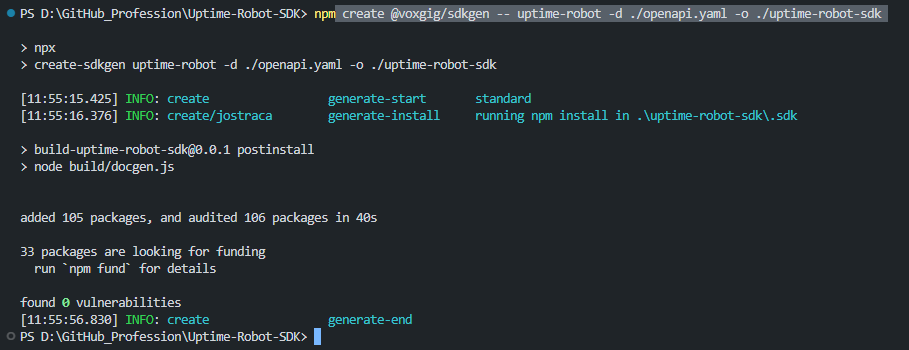
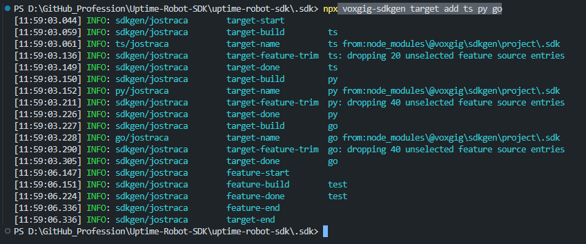
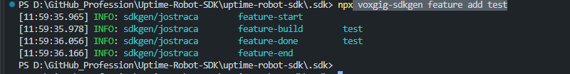
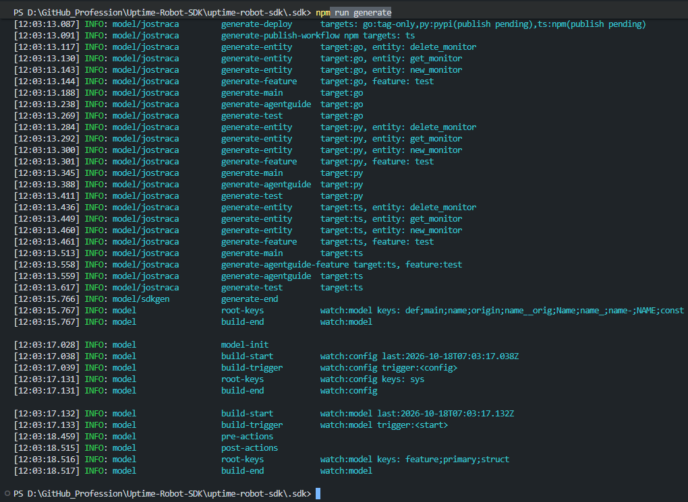
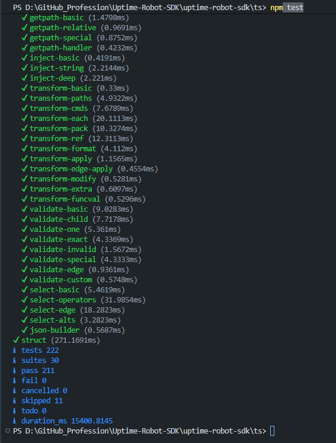
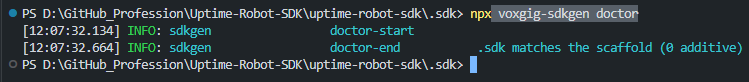

# UptimeRobot SDK

Voxgig-generated SDK for the [UptimeRobot API](https://uptimerobot.com/api/), based on the OpenAPI definition in [`openapi.yaml`](./openapi.yaml).

The generated project is in [`uptime-robot-sdk/`](./uptime-robot-sdk/) and contains TypeScript, Python, and Go targets. The current API definition covers monitor listing, creation, and deletion; it is not a complete implementation of every UptimeRobot API operation.

## SDK scope and documentation

The current OpenAPI definition describes three monitor operations:

- Get monitors
- Create a monitor
- Delete a monitor

Each language target includes generated source, tests, and usage documentation:

- [TypeScript](./uptime-robot-sdk/ts/README.md)
- [Python](./uptime-robot-sdk/py/README.md)
- [Go](./uptime-robot-sdk/go/README.md)

The TypeScript test suite was run from `uptime-robot-sdk/ts` with `npm test` and passed. Python and Go test results remain unverified for the reasons noted above.

## Developer experience report

### Ease of use

The Voxgig generator made it quick to turn an OpenAPI definition into SDKs for multiple languages. The generated project also includes offline test support, so the TypeScript test suite can run without a live API connection or API credentials.

### Architecture

The `.sdk/model/` directory holds the declarative SDK model, while the `ts/`, `py/`, and `go/` directories contain generated language targets. This separates the model from generated output and provides a common source for the supported SDKs.

### Friction points

- **Parameter scope:** API keys belong in the operation payload for this API, not in client-wide configuration.
- **Field names:** Request parameters must match the API specification, including `api_key` rather than camelCase `apiKey`.
- **Generated entry points:** Finding the compiled TypeScript entry point required checking the package metadata and generated reference documentation.
- **Ownership and release setup:** The generated license and package metadata still name Voxgig. Align these with the project owner's intended copyright and publishing namespace before release.

### Time-box

The task ends up within 17 minutes marking a very time efficient solution by Voxgig.

## Generator walkthrough

Terminal Screenshots

